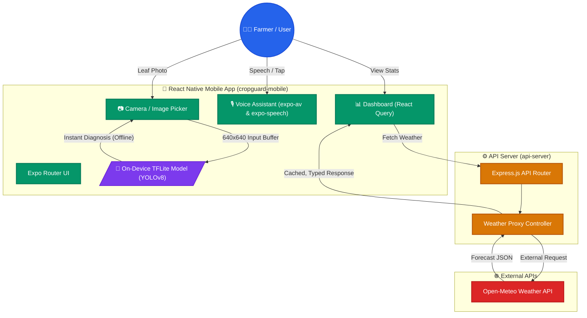

# 🌾 CropGuard AI

[](https://reactnative.dev/)
[](https://expo.dev/)
[](https://www.typescriptlang.org/)
[](https://expressjs.com/)
[](https://ultralytics.com/)
[](https://www.tensorflow.org/lite)
[](https://opensource.org/licenses/MIT)

> **CropGuard AI** is a smart, offline-capable mobile application and agronomy advisory system designed to empower farmers with on-device crop disease diagnosis, hyper-local weather insights, and an accessible AI voice assistant.

---

## 📖 Table of Contents

- [Overview](#-overview)
- [Key Features](#-key-features)
- [System Architecture](#-system-architecture)
- [Tech Stack](#-tech-stack)
- [Repository Structure](#-repository-structure)
- [AI & Machine Learning Pipeline](#-ai--machine-learning-pipeline)
- [Getting Started](#-getting-started)
  - [Prerequisites](#prerequisites)
  - [Installation](#installation)
  - [Running the API Server](#running-the-api-server)
  - [Running the Mobile App](#running-the-mobile-app)
- [Environment Configuration](#-environment-configuration)
- [Roadmap & Future Scope](#-roadmap--future-scope)
- [Contributing](#-contributing)
- [License](#-license)

---

## 🌟 Overview

Crop diseases destroy up to 30% of global agricultural yields every year. While early detection can prevent massive losses, smallholder farmers often lack access to timely expert advice or reliable high-speed internet in remote fields.

**CropGuard AI** bridges this gap:
1. **Edge Intelligence**: Runs AI disease classification locally on the smartphone via **TensorFlow Lite (TFLite)** without requiring an active internet connection.
2. **Accessible UX**: Features an interactive **AI Voice Assistant** so farmers can ask questions and hear recommendations hands-free while working in the field.
3. **Agronomy Decision Support**: Combines disease diagnosis with hyper-local weather conditions and tailored organic/chemical treatment advice.

---

## ✨ Key Features

- **📷 Real-Time & Offline Crop Scanner**: Detects leaf blight, leaf spot, rust, aphids, powdery mildew, and healthy leaves using on-device YOLOv8 TFLite inference.
- **🎙️ AI Voice Assistant**:
  - Hands-free audio recording with `expo-av`.
  - Auditory response playback via native text-to-speech with `expo-speech`.
- **🌤️ Hyper-Local Weather & Soil Dashboard**: Provides real-time weather forecasts and soil conditions via a resilient Open-Meteo backend proxy with offline fallbacks.
- **💊 Targeted Remediation**: Delivers specific prevention measures, chemical usage precautions, and organic fertilizer recommendations.
- **🌓 Adaptive Interface**: Clean, accessible UI with automatic Dark/Light mode support and multi-lingual architecture.

---

## 🏗️ System Architecture



---

## 🛠️ Tech Stack

### Mobile Frontend (`artifacts/cropguard-mobile`)
- **Core**: React Native 0.81.5, Expo SDK 54, TypeScript
- **Navigation**: Expo Router (file-based navigation)
- **Data Fetching**: `@tanstack/react-query` generated via Orval from OpenAPI schema
- **Audio & Media**: `expo-av` (recording) & `expo-speech` (TTS)
- **Camera & Vision**: `expo-image-picker`, `expo-image-manipulator`, `jpeg-js`, `base64-js`
- **UI Components**: Ionicons (`@expo/vector-icons`), `expo-linear-gradient`, `expo-blur`

### Backend Proxy & Services (`artifacts/api-server`)
- **Runtime**: Node.js with Express 5
- **Tooling**: TypeScript, esbuild, pino logger
- **Schema Validation**: Zod (`@workspace/api-zod`)
- **Integration**: Open-Meteo Weather API proxy with CORS and cookie parsing

### Machine Learning & Data Pipeline
- **Architecture**: Ultralytics YOLOv8 Nano (`yolov8n`)
- **Dataset**: 15,300+ annotated leaf images exported from Roboflow
- **Deployment Format**: TensorFlow Lite (`.tflite` float32) optimized for edge mobile inference

---

## 📂 Repository Structure

```text
.
├── artifacts/
│   ├── cropguard-mobile/       # React Native / Expo mobile application
│   │   ├── app/                # Expo Router screens (tabs, scanner, assistant)
│   │   ├── components/         # Reusable UI components
│   │   ├── hooks/              # Custom hooks (colors, theme, query)
│   │   ├── lib/                # Disease detection logic & TFLite parser
│   │   └── assets/             # Icons, splash screens, and ML assets
│   │
│   └── api-server/             # Express.js backend proxy
│       ├── src/                # Controllers, routes, and server configuration
│       └── build.mjs           # ESBuild bundle configuration
│
├── lib/
│   ├── api-client-react/       # Generated React Query hooks & API clients
│   └── api-zod/                # Shared Zod validation schemas
│
├── train_model.py              # Script to train YOLOv8 and export to TFLite
├── package.json                # Monorepo root workspace configuration
└── pnpm-workspace.yaml         # Monorepo packages setup
```

---

## 🧠 AI & Machine Learning Pipeline

1. **Dataset**: Custom annotated dataset with 15,300+ leaf images covering healthy states and multiple plant pathologies (blight, rust, leaf spot, aphids, powdery mildew).
2. **Training**:
   ```bash
   python train_model.py
   ```
   Uses Ultralytics YOLOv8 to train on annotated bounding boxes (`data.yaml`).
3. **TFLite Export**:
   Exported to float32 TFLite (`best_float32.tflite`) with input shape `(1, 640, 640, 3)` for on-device inference without cloud latency.

---

## 🚀 Getting Started

### Prerequisites

- [Node.js](https://nodejs.org/) (v20.x or newer)
- [pnpm](https://pnpm.io/) (v9.x or newer)
- [Python 3.10+](https://www.python.org/) *(only if running training scripts locally)*
- **Expo Go App** on your physical Android/iOS phone ([Play Store](https://play.google.com/store/apps/details?id=host.exp.exponent) or [App Store](https://apps.apple.com/app/expo-go/id982107779))

### Installation

Clone the repository and install dependencies using `pnpm`:

```bash
git clone https://github.com/your-username/cropguard-ai.git
cd cropguard-ai

# Install dependencies across all packages
pnpm install --ignore-scripts
```

### Running the API Server

Start the backend proxy service on port `5000`:

```bash
cd artifacts/api-server
pnpm run build
pnpm run start
```

### Running the Mobile App

In a separate terminal, launch the Expo bundler:

```bash
cd artifacts/cropguard-mobile
pnpm exec expo start -c
```

- **Physical Device**: Scan the generated QR code using the **Expo Go** app on your phone (ensure phone and PC are connected to the same Wi-Fi network).
- **Web Browser**: Press `w` in the terminal to view the responsive web build.

---

## ⚙️ Environment Configuration

### Mobile (`artifacts/cropguard-mobile/.env`)
```ini
# Custom local or hosted TFLite model URL (optional)
EXPO_PUBLIC_YOLO_MODEL_URL=

# Comma-separated list of model output classes
EXPO_PUBLIC_YOLO_CLASS_NAMES="Healthy leaf,Leaf spot,Blight,Rust,Aphids,Powdery mildew"
```

### API Server (`artifacts/api-server/.env`)
```ini
PORT=5000
NODE_ENV=development
```

---

## 🗺️ Roadmap & Future Scope

- [ ] **Drone Integration**: Ingest aerial imagery for large-acreage crop health scanning.
- [ ] **Localized Dialects**: Broaden voice assistant language models to regional dialects (Hindi, Bengali, Telugu, etc.).
- [ ] **E-Marketplace Connector**: Suggest verified biological controls and organic treatments directly from local cooperatives.
- [ ] **Push Alerts for Outbreaks**: Geographic notifications warning farmers of approaching pest or fungal outbreaks.

---

## 🤝 Contributing

Contributions are welcome! Please follow these steps:

1. Fork the Project
2. Create your Feature Branch (`git checkout -b feature/AmazingFeature`)
3. Commit your Changes (`git commit -m 'Add some AmazingFeature'`)
4. Push to the Branch (`git push origin feature/AmazingFeature`)
5. Open a Pull Request

---

## 📄 License

Distributed under the MIT License. See [LICENSE](LICENSE) for more information.

---

Made with ❤️ for sustainable agriculture and empowering farmers worldwide.

